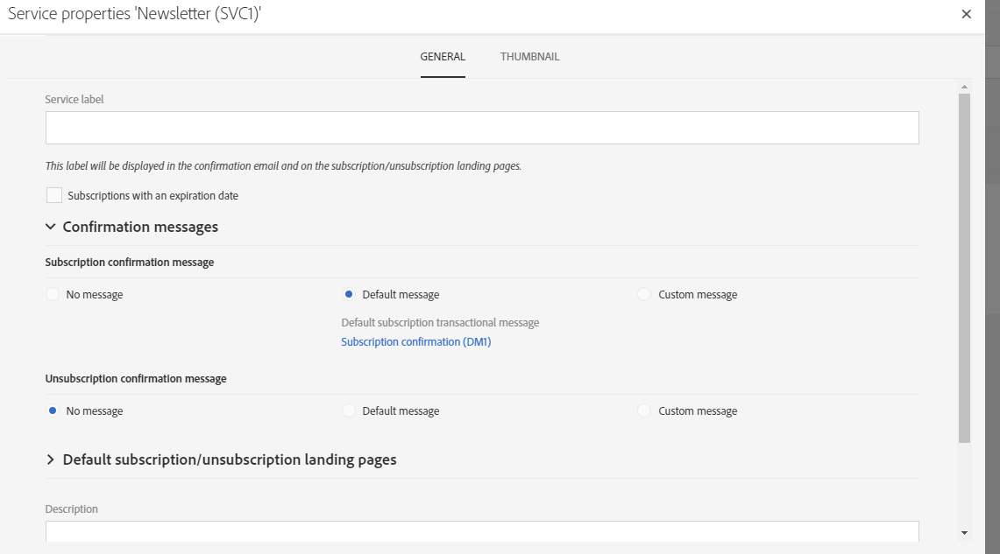
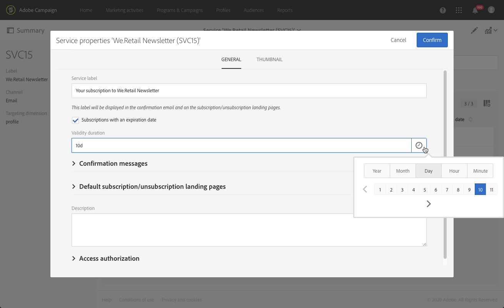

# サービスの作成{#creating-a-service}

サブスクリプションを管理するには、まずサービスを作成し、設定する必要があります。 新しいサービスを設定すると、プロファイルがサービスを登録または登録解除する際に受け取る電子メール確認を指定できます。 また、サービスにリンクされている購読と購読解除のランディングページも定義します。 例えば、電子メールにサービスサブスクリプションリンクを挿入すると、サービスで指定されたサブスクリプションランディングページにプロファイルが自動的に誘導されます。

 [ビデオでこの機能を確認する](#video)

サービスを設定するには、次の手順に従います。

1. Adobe Campaign のロゴから、詳細設定メニューの **[!UICONTROL Profiles & audiences]**／**[!UICONTROL Services]** を選択し、新しいサービスを追加するか、既存のサービスを選択します。 新しいサービスを作成する場合は、画面に表示される手順に従います。

   デフォルトのサービステンプレートを使用できます。 このテンプレートには、デフォルトのランディングページと確認電子メールが事前設定されています。 その他のテンプレートを作成して、特定の設定を定義することもできます。 詳しくは、[テンプレートの管理](../../start/using/marketing-activity-templates.md)の節を参照してください。

1. サービスダッシュボードの「**[!UICONTROL Service properties]**」ボタンから「」セクションにアクセスして、購読および購読解除の確認メッセージを設定します。

   

1. サブスクリプションの有効期間を設定するには、この「**[!UICONTROL Subscriptions with an expiration date]**」オプションを選択します。

   

   セグメント化アクティビティの有効期限を使用すると、期限切れでないサービスを登録しているプロファイルをターゲットに設定できます。

1. 「**[!UICONTROL Service label]**」フィールドに値を入力します。 カスタムの確認メッセージを使用する場合、サービスラベルは必須です。

1. 購読および購読解除の確認メッセージテンプレートを選択します。 次の 3 つのモードを選択できます。

   * **[!UICONTROL No message]**：このモードを使用すると、確認メッセージを表示せずにサービスを作成できます。
   * **[!UICONTROL Default message]**：このモードでは、デフォルトの購読または購読解除確認トランザクションメッセージが使用されます。 デフォルトの確認メッセージは汎用で、デフォルトのモードを使用するすべてのサービスで同じになります。

     >[!NOTE]
     >
     >デフォルトのメッセージを変更するには、「**[!UICONTROL Service properties]**」セクション内のラベルをクリックするか、「**[!UICONTROL Show internal transactional messages]**」ボックスをオンにした後で Adobe Campaign トランザクションメッセージリストからデフォルトのメッセージを選択します。

   * **[!UICONTROL Custom message]**：このモードでは、各サービス特有のカスタム確認メッセージを処理できます。 次に、特定の[トランザクションメッセージ](../../channels/using/getting-started-with-transactional-msg.md)テンプレートに関連付けられている **[!UICONTROL Custom subscription event configuration]** を選択します。 詳しくは、[サービスのサブスクリプションを確認](../../audiences/using/confirming-subscription-to-a-service.md)を参照してください。

1. サービスを保存します。 これで、使用できる状態になりました。

サービスが作成されたら、そのサービスのプロモーションを開始できます。

**関連トピック：**

* [サービスのプロモーション](../../audiences/using/promoting-a-service.md)
* [購読者で構成されたオーディエンスの作成](../../audiences/using/creating-audiences.md#creating-list-audiences)
* [ランディングページとサービスのリンク](../../channels/using/configuring-landing-page.md#linking-a-landing-page-to-a-service)

## チュートリアルビデオ {#video}

このビデオでは、サービスの作成方法とサブスクリプションの管理方法を説明します。

>[!VIDEO](https://video.tv.adobe.com/v/328371?captions=jpn&quality=12)

その他のCampaign Standardのハウツー動画は[こちら](https://experienceleague.adobe.com/docs/campaign-standard-learn/tutorials/overview.html?lang=ja)でご覧いただけます。
