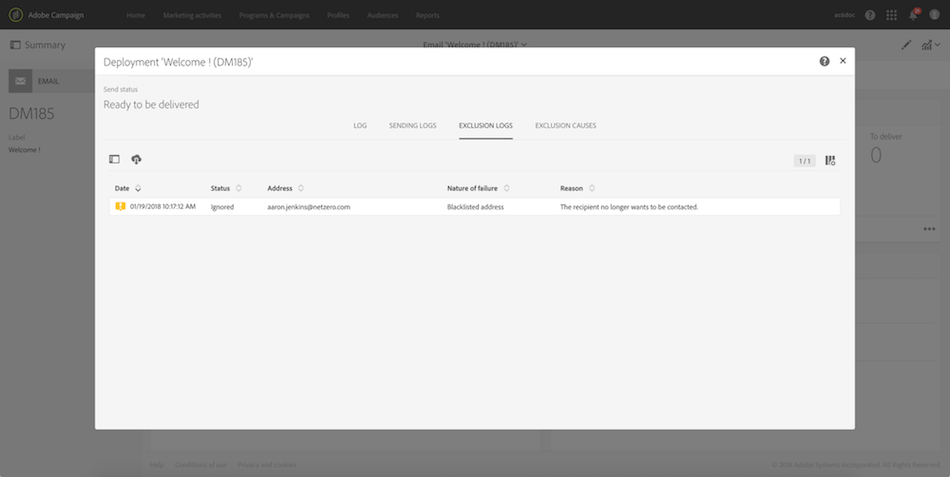

# 配信のオプトアウトプロファイルの識別{#identifying-opt-out-profiles-for-a-delivery}

特定の配信のオプトアウトプロファイルは、準備フェーズの後、配信ダッシュボードの「**[!UICONTROL Exclusion logs]**」タブに一覧表示されます。

**関連トピック：**

* [配信の監視](../../sending/using/monitoring-a-delivery.md#exclusion-logs)。
* [送信を準備しています](../../sending/using/preparing-the-send.md)。
