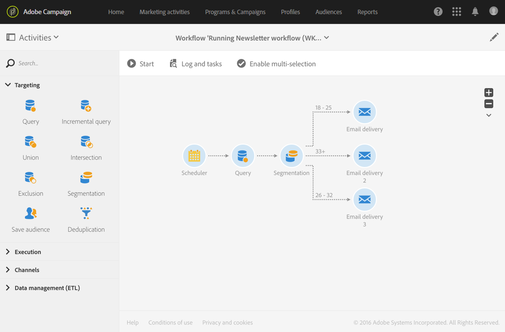
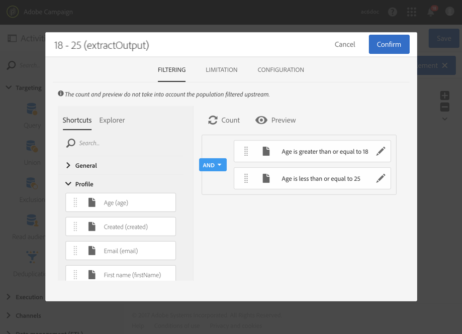
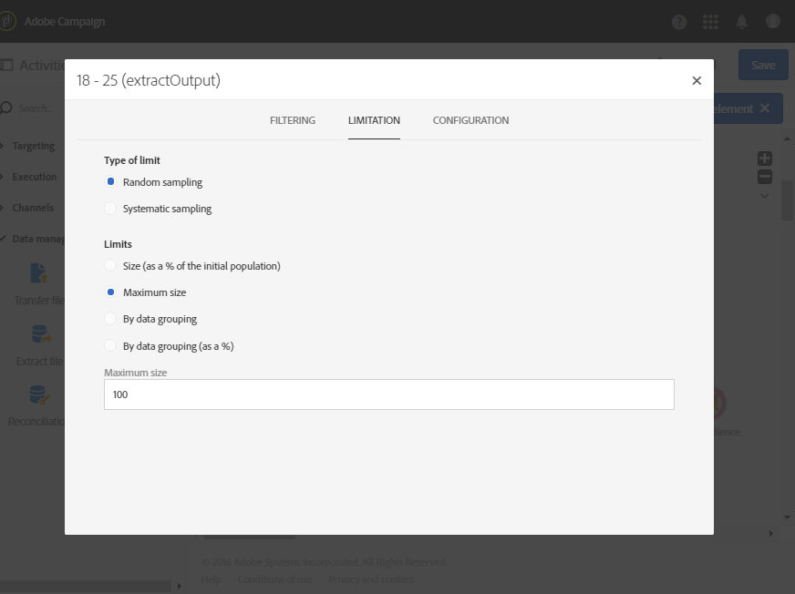

# 年齢層によるセグメント化 {#segmentation-age-groups}

次の例は、年齢グループに応じたデータベースプロファイルのセグメント化を示しています。

このワークフローの目的は、各年齢グループに対して特定のメールを送信することです。 このワークフローがテストキャンペーンの一部であることを考慮し、各セグメントには、制限された代表的なオーディエンスを同時に使用するためにランダムに選択された最大 100 人のプロファイルのみを含めることができます。

ワークフローは、次の要素で構成されています。

* ワークフローの実行日を指定する[&#x200B; スケジューラーアクティビティ &#x200B;](../../automating/using/segmentation.md)。
* 誕生日と電子メールアドレスが入力されたユーザーのプロファイルをターゲットにする[&#x200B; クエリ &#x200B;](../../automating/using/query.md) アクティビティ。
* 異なるアウトバウンドトランジションに分けられた3つのセグメントを作成する[&#x200B; セグメント &#x200B;](../../automating/using/segmentation.md) アクティビティ（18～25歳、26～32歳、32歳以上のプロファイル）。 セグメントは、次のパラメーターに従って定義されます。

  

  * セグメントの年齢グループを定義する年齢に関するフィルター

    

  * **[!UICONTROL Maximum size]** の上限（100）にリンクされた **[!UICONTROL Random sampling]** タイプ制限

    

* セグメントごとの[&#x200B; メール配信](../../automating/using/email-delivery.md) アクティビティ。
