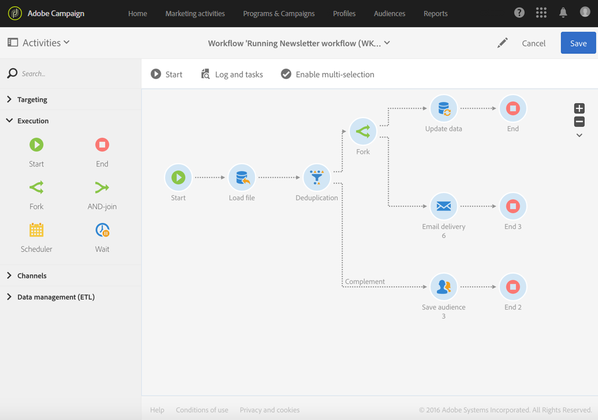

# 開始と終了{#start-and-end}

## 説明 {#description}

「**[!UICONTROL Start]**」アクティビティと「**[!UICONTROL End]**」アクティビティを使用すると、ワークフローの開始点および終了点を明確に示すことができます。

## Context of use {#context-of-use}

ワークフローの実行がインバウンドトランジションを使用しないアクティビティで開始され、進行中のタスクがなくなると停止します。 ただし、ワークフローの開始点と終了点を明確に示すために、「**[!UICONTROL Start]**」アクティビティと「**[!UICONTROL End]**」アクティビティを追加することができます。 これは、比較的複雑なワークフローで特に役立ちます。

ワークフローが正しく終了するように、最後のトランジションをそのままにしておく代わりに「**[!UICONTROL End]**」アクティビティを使用することをお勧めします。

## 設定 {#configuration}

1. ワークフローに「**[!UICONTROL Start]**」アクティビティまたは「**[!UICONTROL End]**」アクティビティをドラッグ＆ドロップします。
1. クエリなどの他のアクティビティの前に「**[!UICONTROL Start]**」アクティビティを配置し、一連のアクティビティの後に「**[!UICONTROL End]**」アクティビティを配置します。
1. アクティビティを選択し、表示されるクイックアクションの  ボタンを使用して開きます。
1. **End** オブジェクトを設定して、ワークフローの進行中のタスク（完了していないタスクを含む）をすべて中断することができます。 これを実行するには、対応するオプションを選択します。
1. アクティビティの設定を確認し、ワークフローを保存します。

## 別のワークフローのトリガー {#triggering-another-workflow}

「**[!UICONTROL End]**」アクティビティの「**[!UICONTROL External signal]**」タブを使用して、別のワークフローをトリガーできます。 [外部シグナル](../../automating/using/external-signal.md)の節を参照してください。

## 例 {#example}

次の例は、「**[!UICONTROL Start]**」アクティビティと複数の「**[!UICONTROL End]**」アクティビティを使用して複雑なワークフローを実行する方法を示しています。 最初の「**[!UICONTROL End]**」アクティビティの「**[!UICONTROL Stop all tasks in progress]**」チェックボックスにチェックが入っています。 対応するタスクが完了すると、ワークフロー全体が停止します。 ボタンが選択された場合と同じ効果が得られます（[アクションバー](../../automating/using/workflow-interface.md#action-bar)の節を参照）。

