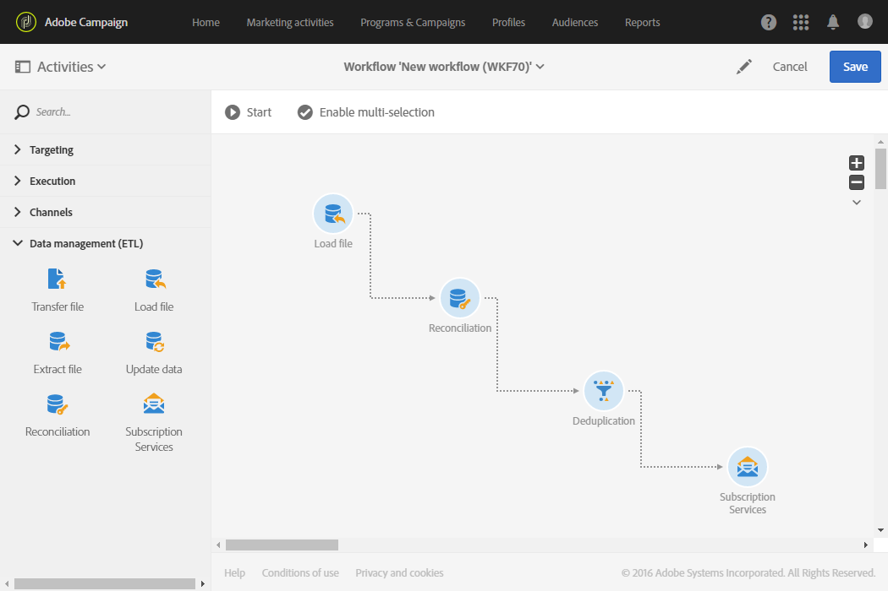
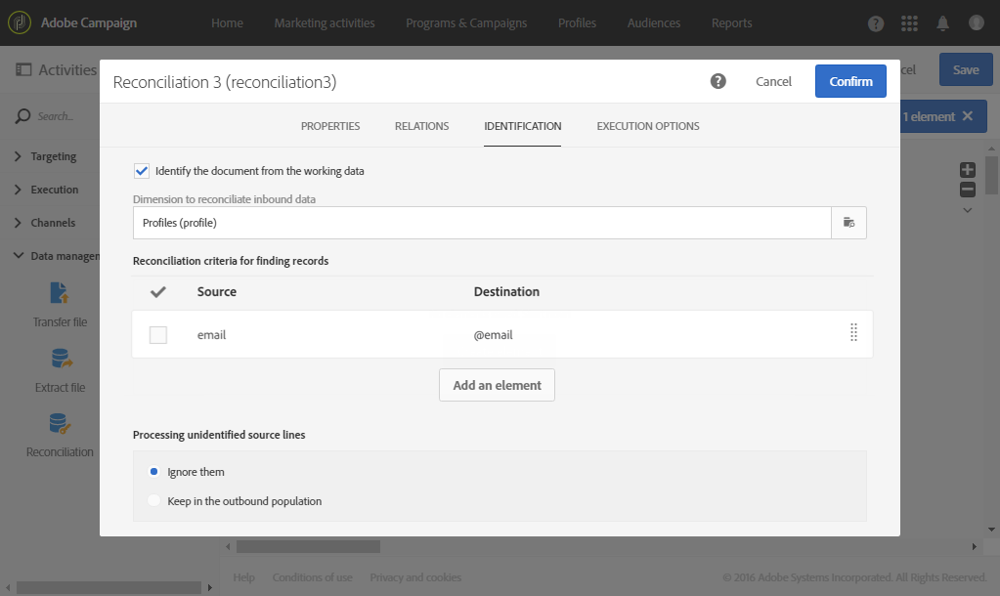
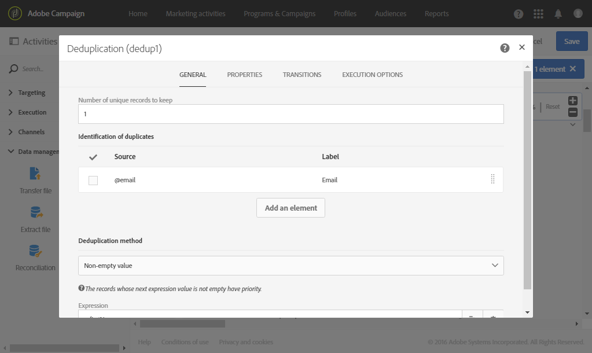

# ファイルを読み込んだ後の特定のサービスへのプロファイルの登録 {#subscribing-profiles-to-a-specific-service-after-importing-a-file}

次の例では、プロファイルを含んだファイルをインポートし、これらのプロファイルを既存のサービスに購読登録する方法を示します。 ファイルをインポートした後で、インポートしたデータをプロファイルとして識別できるように紐付けをおこなう必要があります。 ファイルに重複が含まれていないことを確認するために、データに対して「重複排除 - 重複」アクティビティが実行されます。

ワークフローは次のとおりです。



* [&#x200B; ファイルの読み込み](../../automating/using/load-file.md) アクティビティは、プロファイルファイルを読み込み、読み込まれた列の構造を定義します。

  この例では、読み込まれるファイルは .csv 形式で、次のデータが含まれています。

  ```
  lastname;firstname;email;birthdate;subdate
  jackman;megan;megan.jackman@testmail.com;07/08/1975;10/08/2017
  phillips;edward;phillips@testmail.com;09/03/1986;10/08/2017
  weaver;justin;justin_w@testmail.com;11/15/1990;10/08/2017
  martin;babeth;babeth_martin@testmail.net;11/25/1964;10/08/2017
  reese;richard;rreese@testmail.com;02/08/1987;11/08/2017
  cage;nathalie;cage.nathalie227@testmail.com;07/03/1989;11/08/2017
  xiuxiu;andrea;andrea.xiuxiu@testmail.com;09/12/1992;11/08/2017
  grimes;daryl;daryl_890@testmail.com;12/06/1979;12/08/2017
  tycoon;tyreese;tyreese_t@testmail.net;10/08/1971;12/08/2017
  ```

  

* [紐付け](../../automating/using/reconciliation.md)アクティビティでは、Adobe Campaign データベースのプロファイルディメンションに属するものとして、ファイルのデータが識別されます。 「**[!UICONTROL Identification]**」タブのみ設定します。 プロファイルのメールアドレスに従って、ファイルデータを識別します。

  

* 一時リソースの&#x200B;**電子メール** フィールドに基づく[重複排除](../../automating/using/deduplication.md)は、（紐付けの結果として）重複を識別します。 ファイルからインポートしたデータに重複が含まれている場合、サービスへの購読登録はすべてのデータで失敗します。

  

* [&#x200B; サブスクリプションサービス &#x200B;](../../automating/using/subscription-services.md) アクティビティを使用すると、プロファイルを購読する必要があるサービス、購読日に対応するフィールド、購読の送信元を選択できます。

  
