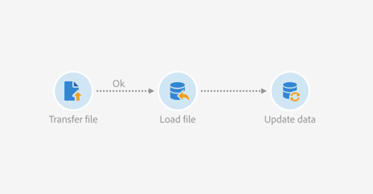
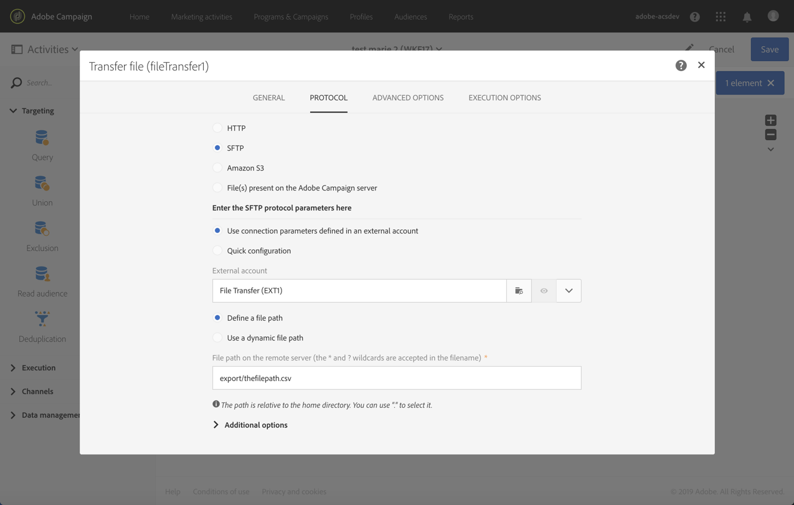

# ファイルの自動ダウンロードに基づくデータの更新 {#updating-data-automatic-file-download}

「ファイル読み込み」アクティビティは主に、「ファイル転送」アクティビティから取得したデータを構造化し、既存のデータに統合します。

次の例は、「ファイル転送」アクティビティから自動的に「ファイル読み込み」アクティビティがダウンロードされ、「データ更新」アクティビティがその後に実行された場合の結果を示しています。 このワークフローでは、Adobe Campaign データベースを新しいプロファイルで拡張したり、インポートしたファイルから回復したデータを使用して既存のプロファイルを更新することを目的としています。

ワークフローを構築するには、次の手順に従います。

1. 「[Transfer file](../../automating/using/transfer-file.md)」アクティビティをワークフローにドラッグ＆ドロップします。
1. アクティビティを選択し、表示されるクイックアクションの  ボタンを使用して開きます。
1. 必要なファイルを復元できるように、アクティビティを設定します。 「**[!UICONTROL Protocol]**」タブで「**SFTP**」を選択します。
1. 「**Use connection parameters defined in an external account**」オプションを選択します。
1. 外部アカウントの名前を入力します。
1. **リモートサーバーのファイルパス**&#x200B;を入力します。

   

1. アクティビティを確認します。
1. [ ファイルを読み込み](../../automating/using/load-file.md) アクティビティをワークフローにドラッグ&amp;ドロップし、**[!UICONTROL Transfer file]** アクティビティの後に配置します。
1. アクティビティを選択し、表示されるクイックアクションの  ボタンを使用して開きます。
1. 「**[!UICONTROL Execution]**」タブの「**[!UICONTROL File to load]**」セクションで、「**[!UICONTROL Use the file specified in the inbound transition]**」オプションをオンにします。

   

1. 前の指定内容に従って、アクティビティを設定します。
1. [ データの更新](../../automating/using/update-data.md) アクティビティをワークフローにドラッグ&amp;ドロップし、**[!UICONTROL Load file]** アクティビティの後に配置してから設定します。

ワークフローが開始されると、アップロードされたファイルのデータが抽出され、Adobe Campaign データベースの拡張に使用されます。
