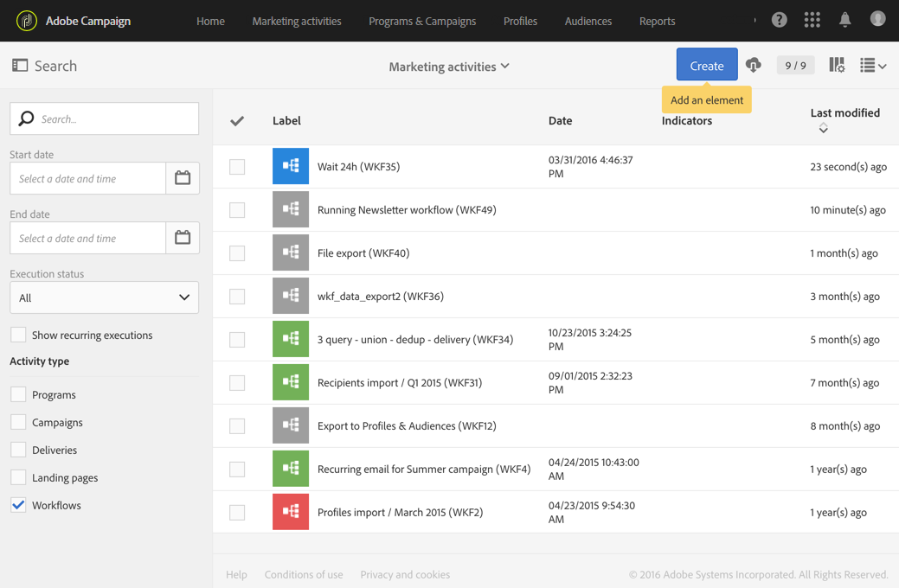

# ワークフローのライフサイクル {#life-cycle}

ワークフローのライフサイクルには3つの主要なステップがあり、各ステップはステータスと色にリンクされています。

* **編集** （グレー）

  これは、ワークフローの最初の設計フェーズです（[ ワークフローの作成](../../automating/using/building-a-workflow.md#creating-a-workflow)を参照）。 ワークフローはまだサーバーによって処理されておらず、リスクなしに変更できます。

* **進行中** （青）

  最初の設計フェーズが完了すると、ワークフローを開始し、サーバーが処理します。

* **完了** （緑）

  処理中のタスクがなくなった場合、またはオペレーターがインスタンスを明示的に停止した場合、ワークフローは終了します。

ワークフローを開始すると、他にも2つのステータスが表示される場合があります。

* **警告** （黄色）

  ワークフローを完了できなかったか、または ボタンを使用して一時停止しました。

* **エラー** （赤）

  ワークフローの実行時にエラーが発生しました。 ワークフローが停止されました。ユーザーはアクションを実行する必要があります。 このエラーの詳細については、 ボタンを使用してワークフローログにアクセスしてください（[監視](../../automating/using/monitoring-workflow-execution.md)を参照）。

マーケティング活動のリストを使用すると、すべてのワークフローとそのステータスを表示できます。 詳しくは、「[ マーケティング活動の管理](../../start/using/marketing-activities.md#about-marketing-activities)」を参照してください。

