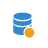
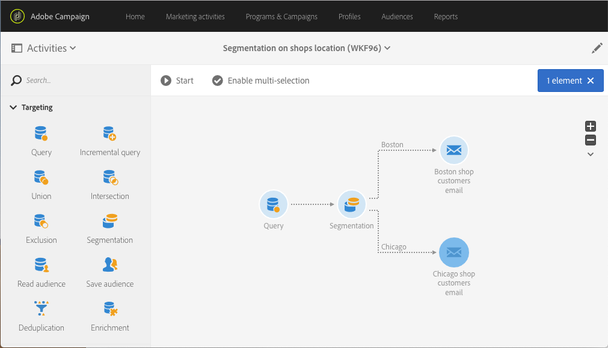

# 位置情報のセグメント化 {#segmentation-on-location}

地元の店舗でのオファーで顧客にターゲティングメールを送信できます。

1. 「**[!UICONTROL Marketing Activities]**」で、「**[!UICONTROL Create]**」をクリックして「**[!UICONTROL Workflow]**」を選択します。
1. ワークフローのタイプとして「**[!UICONTROL New Workflow]**」を選択し、「**[!UICONTROL Next]**」をクリックします。
1. ワークフローのプロパティを入力し、「**[!UICONTROL Create]**」をクリックします。

## 電子メールで連絡できる受信者の選択{#selecting-recipients-contactable-via-email}

1. **[!UICONTROL Activities]** > **[!UICONTROL Targeting]**&#x200B;で、[&#x200B; クエリ &#x200B;](../../automating/using/query.md) アクティビティ をドラッグ&amp;ドロップします。
1. アクティビティをダブルクリックします。
1. 「**[!UICONTROL Shortcuts]**」で、「**[!UICONTROL Profiles]**」をドラッグ＆ドロップし、演算子「**[!UICONTROL email]**」を使用してフィールド「**[!UICONTROL is not empty]**」を選択します。
1. 「**[!UICONTROL Shortcuts]**」で、「**[!UICONTROL Profiles]**」をドラッグ＆ドロップして、値「**[!UICONTROL no longer contact by email]**」を含むフィールド「**[!UICONTROL no]**」を選択します。
1. 「**[!UICONTROL Confirm]**」を 2 回クリックします。

## セグメント化アクティビティの作成{#creating-a-segmentation-activity}

1. 「[&#x200B; セグメント化](../../automating/using/segmentation.md)」アクティビティをドラッグ&amp;ドロップし、ダブルクリックします。
1. セグメントをクリックし、トランジションを開いて、最初の都市の人をターゲットにします。 ボストンです。
1. 「**[!UICONTROL Location]**」をドラッグ＆ドロップし、演算子「**[!UICONTROL equals to]**」と値「**[!UICONTROL Boston]**」を使用して、「**[!UICONTROL City]**」を選択します。
注意：ボストンに入ったすべての人に連絡するには、大文字と小文字を区別しないで、「大文字と小文字を区別する」オプションをオフにします。
1. 「**[!UICONTROL Confirm]**」をクリックします。
1. 「**[!UICONTROL List of outbound segments]**」で、「**[!UICONTROL Add an element]**」をクリックし、「」をクリックして、2 番目の都市の人をターゲティングしたセグメントを作成します。 シカゴです。
1. 「**[!UICONTROL Location]**」をドラッグ＆ドロップし、演算子「**[!UICONTROL City]**」を使用して「**[!UICONTROL equals to]**」を選択し、値に「**[!UICONTROL Chicago]**」を入力します。
1. シカゴに入ったすべての人に連絡するには、大文字と小文字を区別しないで、「大文字と小文字を区別する」オプションをオフにします。
1. 「**[!UICONTROL Confirm]**」をクリックします。

## メール配信の作成{#creating-an-email-delivery}

1. **[!UICONTROL Activities]** > **[!UICONTROL Channels]**&#x200B;で、各セグメントの後ろに[&#x200B; メール配信](../../automating/using/email-delivery.md) アクティビティをドラッグ&amp;ドロップします。
1. アクティビティをクリックし、 を選択して編集します。
1. 「**[!UICONTROL Simple email]**」を選択し、「**[!UICONTROL Next]**」をクリックします。
1. メールテンプレートを選択し、「**[!UICONTROL Next]**」をクリックします。
1. メールのプロパティを入力し、「**[!UICONTROL Next]**」をクリックします。
1. メールのレイアウトを作成するには、「**[!UICONTROL Email Designer]**」をクリックします。
1. 要素を挿入するか、既存のテンプレートを選択します。
1. 各場所に固有のオファーを使用して、メールをパーソナライズします。

   詳しくは、[メールのデザイン](../../designing/using/designing-from-scratch.md#designing-an-email-content-from-scratch)を参照してください。

1. 「**[!UICONTROL Preview]**」をクリックして、レイアウトを確認します。
1. 「**[!UICONTROL Save]**」をクリックします。

