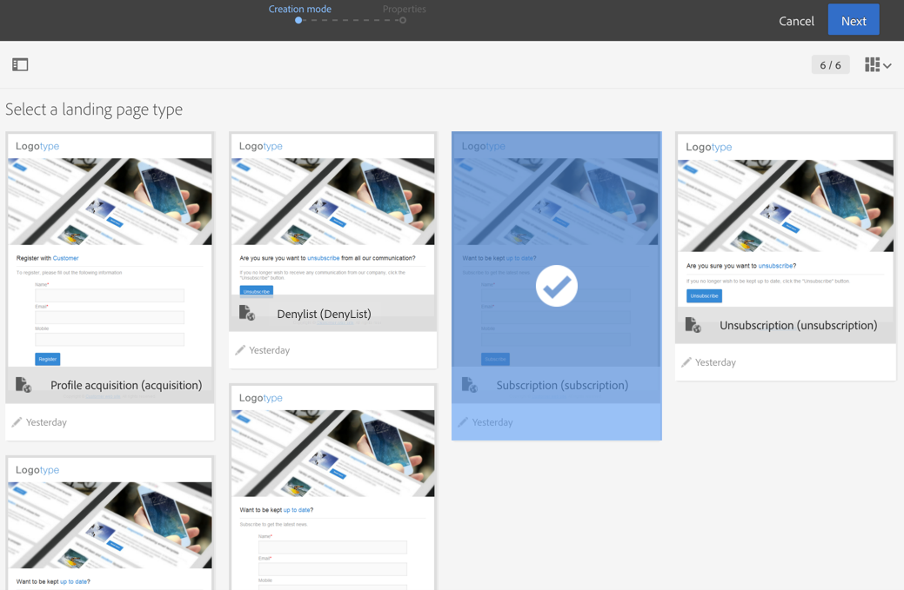

# ランディングページテンプレートについて {#landing-page-templates}

Campaign には、次の一連のランディングページテンプレートがビルトインされています。

* **[!UICONTROL Acquisition]**：ランディングページのデフォルトテンプレートで、これを使用すると、Campaign データベースのデータを取得および更新できます。
* **[!UICONTROL Subscription]**：サービスのサブスクリプションをオファーする場合に使用するテンプレートです。
* **[!UICONTROL Unsubscription]**：サービスの購読登録者に送信されたメールからリンクできるテンプレートで、これを使用して登録者がこのサービスを登録解除できます。
* **[!UICONTROL Denylist]**：プロファイルが Campagin からの配信の受信を中止する場合に使用するテンプレートです。 ブロックリストに加えるの管理について詳しくは、[Campaignでのオプトインとオプトアウトについて](../../audiences/using/about-opt-in-and-opt-out-in-campaign.md)を参照してください。

これらのテンプレートは、新しいランディングページを作成する際にデフォルトで提示されます。



ランディングページテンプレートにアクセスするには、左上隅の Adobe Campaign ロゴをクリックし、**[!UICONTROL Resources]**／**[!UICONTROL Templates]**／**[!UICONTROL Landing page templates]**&#x200B;を選択します。

>[!NOTE]
>
>ビルトインのテンプレートを複製して、独自のテンプレートを作成することをお勧めします。 一部のパラメーターは、ランディングページテンプレートでのみ設定可能で、ランディングページでは直接変更できません。

テンプレートを作成する場合は、「**type**」属性をタグに追加することをお勧めします。 この情報はエディターで処理され、Web アプリケーションの設定時に、ユーザーがデータベースフィールドをフォームフィールドにリンクするのに役立ちます。

テンプレート内の HTML コードの例：

```
<input id="email" type="email" name="email"/>
```

「type」属性の正式なリストは、[https://www.w3schools.com/tags/att_input_type.asp](https://www.w3schools.com/tags/att_input_type.asp) で入手できます。
