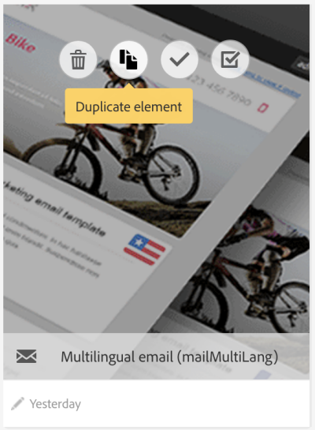
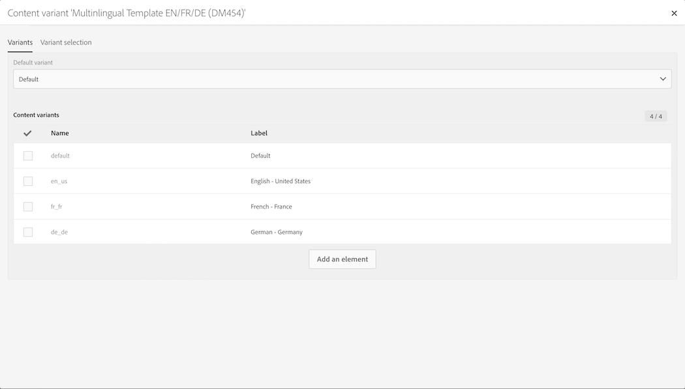
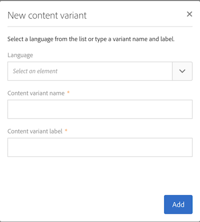

# 多言語メッセージテンプレート {#multilingual-messages-template}

多言語テンプレートは、多言語メッセージを管理するための固有のテンプレートです。 このテンプレートは、**メール**&#x200B;や **SMS** メッセージに対して、スタンドアロンモード、ワークフロー内、または繰り返し配信で使用できます。

多言語機能テンプレートでは、言語管理はバリアントに基づいています。 **各バリアントは 1 つの言語を表します**。 Adobe Campaign Standard では、最大 40 個のバリアントを設定できます。

Adobe Campaign では、デフォルトの言語が **EN** に設定されています。 デフォルトの言語は別のバリアントに変更できますが、削除しないでください。

テンプレートの作成時に、メッセージで必要な言語の数に対応するバリアントの数を追加できます。

SMS やメールのテンプレート作成を実行するには、次の手順に従います。

1. 既存の多言語テンプレート（SMS またはメール）を複製します。

   

   >[!NOTE]
   >
   >また、テンプレートプロパティの「**[!UICONTROL Initialize content variant]**」ボタンをクリックして、多言語テンプレート内の既存の標準テンプレートを変更することもできます。

1. プロパティを変更して、ラベルやトラッキングなどをカスタマイズします。

1. バリアントの数を変更するには、バリアントタイルをクリックします。 バリアントウィンドウが表示されます。

   

   バリアントを追加または削除できます。 バリアントを追加するには、**[!UICONTROL New content variant]** ウィンドウで必要事項を入力します。

   

   >[!NOTE]
   >
   >「default」バリアントは、指定された優先言語パラメーターがないプロファイルに送信されるバリアントなので、削除しないでください。

1. 必要に応じてラベルのバリアントをカスタマイズし、「**[!UICONTROL Confirm]**」をクリックします。

1. 各バリアントのコンテンツを直接追加することもできます。

これで、この多言語テンプレートに基づくメールまたは SMS メッセージを作成する準備ができました。

**関連トピック：**

* [多言語メールの作成](../../channels/using/creating-a-multilingual-email.md)
* [プロファイルの作成](../../audiences/using/creating-profiles.md)
