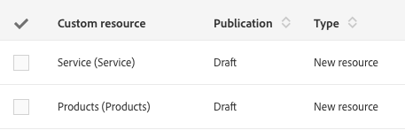

# リソースのステータス{#resource-statuses}

リソースのステータスは、公開ステータスやアクティベーションステータスに応じて異なります。

これらのステータスを&#x200B;**[!UICONTROL Custom resources]**&#x200B;画面に表示する専用の列が2つあります。

**公開状況**

* **ドラフト**: リソースが作成または再作成されました。 データベーステーブルと対応するAPIを作成するには、リソースを再公開する必要があります。 リソースが再作成される場合、公開ステップの後にリソースは自動的に非アクティブになります。
* **リドラフトの保留中**: リソースがリドラフトされました。 再作成プロセスは、次の公開中に行われます。 再作成は不可逆的です。 再作成と公開の準備の両方で、ユーザーに通知する警告メッセージがいくつか表示されます。

  再作成について詳しくは、[&#x200B; リソースの削除](../../developing/using/deleting-a-resource.md)を参照してください。

  >[!NOTE]
  >
  >**[!UICONTROL Cancel re-draft]** オプションは、再作成するリソースに「公開済み」ステータスの他のリソースを介したリンクが引き続き含まれている場合に使用できます。 このオプションを使用すると、「再ドラフト」プロセスを元に戻すことができます。 カスタムリソースは元のステータスに戻ります。

* **公開済み**: リソースが公開されました。 リソースが最終変更日の後に変更された場合、最新の変更を考慮するためにリソースの再公開を促すメッセージが表示されます。

**[!UICONTROL Do not publish latest modifications]** フィールドは、今後の公開中に変更が考慮されないようにします。

このフィールドは、カスタムリソース定義で設定できます。
