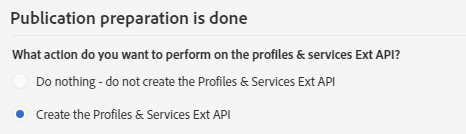
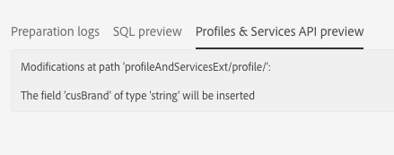

# 手順 2：拡張機能を公開する{#step-publish-the-extension}

1. 詳細設定メニューの Adobe Campaign ロゴから、**[!UICONTROL Administration]**／**[!UICONTROL Development]**／**[!UICONTROL Publication]** を選択します。
1. 「**[!UICONTROL Prepare Publication]**」ボタンをクリックします。
1. 「**[!UICONTROL Create the Profiles & Services Ext API]**」オプションを選択します。

   

   >[!NOTE]
   >
   >APIが既に公開されている場合（つまり、このリソースまたは別のリソースに対してこのオプションを1回チェックした場合）、APIの更新が強制されます。

1. 「**[!UICONTROL Profiles & Services API Preview]**」タブをクリックします。

   これにより、APIの公開が現在のバージョンのprofilesAndServicesExt APIに適用される変更が表示されます。

   ここでは、プロモーションコード フィールド（ID:cusBrand）がAPIに挿入されます。

   

1. 「**[!UICONTROL Publish]**」ボタンをクリックします。
