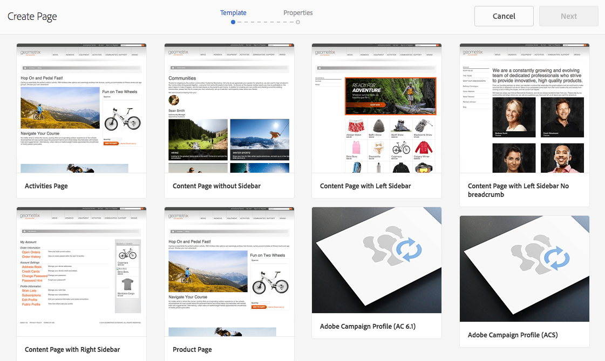

# Experience Manager での Campaign フォームの作成 {#creating-a-campaign-form-in-experience-manager}

AEM サイトで「フォーム」を作成し、フォームのフィールドをAdobe Campaign データベースのフィールドにマッピングできます。 これにより、プロファイルを作成および更新したり、サービスのサブスクリプションを管理したりできます。

AEM サイトでAdobe Campaign フォームを作成するには：

1. AEM サイトで、**Adobe Campaign プロファイル** テンプレートに基づいて新しいページを作成します。

   

1. ページプロパティで、Adobe Campaign インスタンスに対応する&#x200B;**[!UICONTROL Cloud Service]**&#x200B;を選択します。

   

1. **[!UICONTROL Form Start]** コンポーネントからフォームタイプを選択します。

   * **Adobe Campaign: プロファイルを保存**
   * **Adobe Campaign: サービスの購読**
   * **Adobe Campaign: サービスの購読を解除**

1. Adobe Campaign データベースのフィールドにマッピングできる様々なフィールドとコンポーネントを追加して、フォームのコンテンツを編集します。
1. フォームをテストして公開し、AEM サイトからアクセスできるようにします。

詳しくは、[詳細ドキュメント](https://experienceleague.adobe.com/docs/experience-manager-65/authoring/aem-adobe-campaign/adobe-campaign-forms.html?lang=ja)を参照してください。
