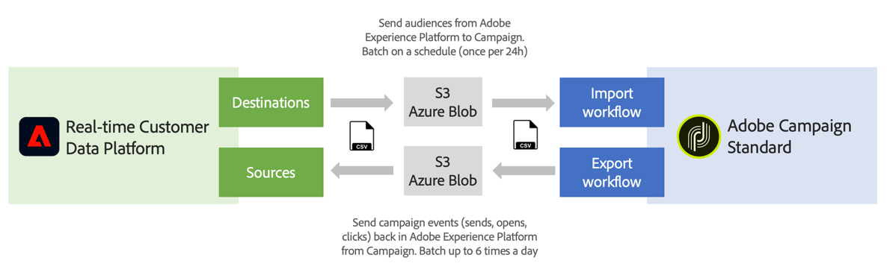

# ソースと宛先の概要 {#rtcdp}

## ソースと宛先について

Adobe Experience Platformでは、Campaign StandardとAdobe Real-time Customer Data Platform （RTCDP）間でデータを共有できます。 これにより、Campaign ワークフローで Adobe Experience Platform のオーディエンスをターゲットにして、オーディエンスに関するデータ（送信数、開封数、クリック数など）をアドビのリアルタイム顧客データプラットフォームに返すことができます。

* **宛先**&#x200B;を使用して、Adobe Experience PlatformからCampaign Standardにオーディエンスを取り込みます。 これにより、マーケティングキャンペーンで既知のデータや不明なデータを活用することができます。
* **ソース**&#x200B;を使用して、Campaign Standard データ（送信、開封、クリックなど）をAdobe Experience Platformに書き出します。 これにより、異なるソースから収集したデータを 1 か所に集め、得られたインサイトを利用してより多くのことを実行できます。

>[!IMPORTANT]
>
>この統合を使用する際は、Adobe Campaign の契約条件が定める SFTP ストレージ、データベースストレージ、アクティブプロファイルの制限に注意してください。

アドビのリアルタイム顧客データプラットフォーム、宛先、ソースについて詳しくは、次のページを参照してください。

* [アドビのリアルタイム顧客データプラットフォーム](https://experienceleague.adobe.com/docs/experience-platform/rtcdp/overview.html?lang=ja)
* [宛先に関するドキュメント](https://experienceleague.adobe.com/docs/experience-platform/destinations/home.html?lang=ja)
* [ソースに関するドキュメント](https://experienceleague.adobe.com/docs/experience-platform/sources/home.html?lang=ja)

## Campaign StandardとAdobe Experience Platformの連携

Adobe Experience PlatformとCampaign Standard間でデータを共有するには、まずAdobe Campaignを&#x200B;**宛先**&#x200B;として接続し、AWS S3またはAzure BLOB ストレージの場所を&#x200B;**Source**&#x200B;としてAdobe Experience Platformに接続する必要があります。

コネクタを設定したら、ワークフローを使用してデータのインポートまたはCampaign Standardへのエクスポートを設定できます。

これらのインポートおよびエクスポートプロセスの設定方法について詳しくは、次の節を参照してください。

* [Campaign への Adobe Experience Platform オーディエンスの取り込み](../../integrating/using/ingest-aep-data.md)
* [Campaign から Adobe Experience Platform へのデータのエクスポート](../../integrating/using/export-campaign-data.md)
