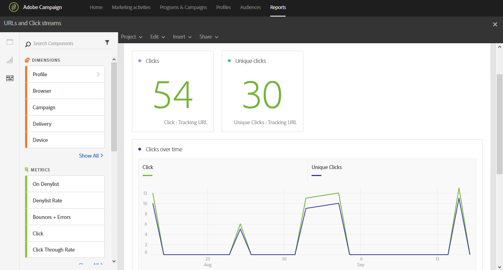

# URL とクリックストリーム{#urls-and-click-streams}

**URL とクリックストリーム**&#x200B;には、配信中に最もクリックされた URL や、キャンペーンまたはプログラムにリンクされている場合は複数の配信が表示されます。

各テーブルは、概要の数値とグラフで表されています。 それぞれのビジュアライゼーション設定で、詳細の表示方法を変更できます。

**最も多く訪問されたリンク**&#x200B;テーブルには、配信ごとの受信者の行動に関する次のような利用可能なデータが含まれます。

* **クリック**：1 つの配信で、あるコンテンツがクリックされた回数。
* **ユニーククリック数**：1 つの配信で、あるコンテンツをクリックした受信者の数。
